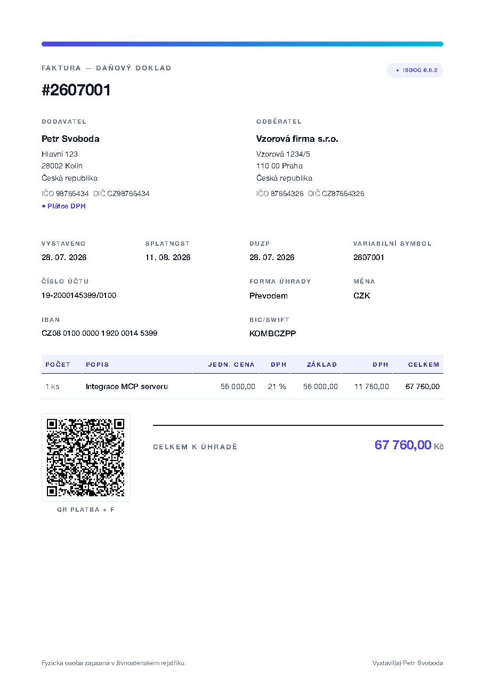
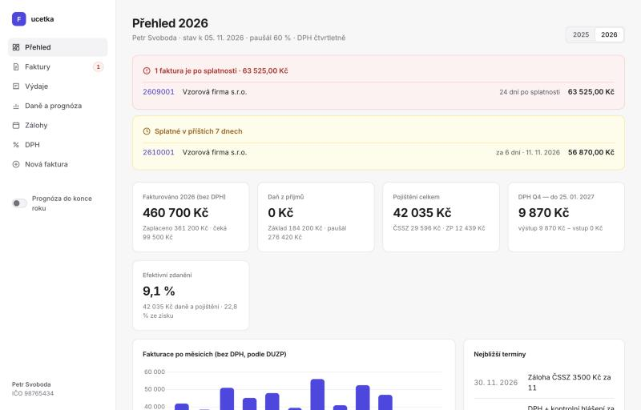

# ucetka-mcp

[](https://github.com/kubanekmartin/ucetka-mcp/actions/workflows/tests.yml)
[](LICENSE)
[](https://glama.ai/mcp/servers/kubanekmartin/ucetka-mcp)

**AI-native accounting for Czech freelancers (OSVČ), driven from an AI chat via MCP.**

Tell your AI assistant *"issue an invoice to Vzorová firma for 4 hours of consulting at 2 500 CZK"* and ucetka-mcp
produces a legally complete Czech invoice (PDF/A-3 with embedded ISDOC and a QR payment code), records it, and later
turns your records into the VAT return, control statement and income-tax estimate. Everything runs locally on your Mac.

<p>
  
  
</p>

<sub>Sample invoice and dashboard with fictional data.</sub>

> [!WARNING]
> **Not tax advice.** ucetka-mcp is a personal open-source tool, not a certified accounting product. Tax and insurance
> calculations are estimates. Always review generated invoices, VAT returns and statements before you file them,
> and consult a tax advisor (daňový poradce) when in doubt. The authors accept no liability for errors or penalties.

## What it does

- **Invoices and credit notes** that meet the Czech VAT Act (§ 28–35 and § 45 of Act 235/2004 Coll.): PDF/A-3a with
  an embedded **ISDOC 6.0.2** XML (`invoice.isdoc`, validated against the official XSD and Schematron rules), so
  accounting software can import them, and a **QR Platba** code (SPAYD, optionally QR Platba+F with invoice data).
- **VAT payer or non-payer**, EU **reverse charge**, foreign currencies with the Czech National Bank rate on the tax
  point date, Czech or English PDF layout.
- **Records**: issued invoices (the single source of invoice numbering), received invoices for VAT deduction, payments;
  received invoices are read from ISDOC (embedded in the PDF or a standalone `.isdoc` file) and the rest is entered
  by the AI from the PDF; import of existing ISDOC PDFs, company lookup in the public **ARES** registry.
- **VAT filings as XML for the tax portal (EPO)**: VAT return (DPHDP3), control statement (DPHKH1) and EC sales list
  (DPHSHV).
- **Income tax and insurance**: personal income tax with flat-rate or actual expenses, social and health insurance for
  side activity, year-end forecast, monthly advances (with QR codes), deadlines, limits.
- **Cash-basis bookkeeping** (daňová evidence): income and expense book as CSV/PDF.
- **Pohoda XML export** (Stormware, validated against the vendored XSD).
- **Local web dashboard** (FastAPI) for people who prefer clicking to chatting.

## Who it is for

Czech sole traders (OSVČ) who invoice in CZK or EUR and want to run their paperwork from Claude (or another MCP client)
instead of a SaaS like Fakturoid. It encodes Czech rules (VAT Act, Income Tax Act, ČSSZ/VZP), so it is of little use
outside the Czech Republic. Currently macOS only (Homebrew, LaunchAgent, Mail.app drafts).

## How it works

```
Claude Desktop / Claude Code / Antigravity
        │  MCP (stdio)
        ▼
  ucetka-mcp server ──► issue pipeline: Pydantic model → WeasyPrint PDF/A-3 → ISDOC (Jinja2 + lxml XSD) → pikepdf embed
        │                                              → QR Platba (SPAYD)
        ├─► records   ~/.ucetka/ (YAML + JSON, plain files)
        ├─► PDFs      ~/Documents/Účetnictví/Vydané faktury/YY_MM_vydane/
        └─► filings   ~/Documents/Účetnictví/Přehledy/<year>/ (EPO XML, book of income and expenses)

  ucetka CLI  ·  web dashboard http://127.0.0.1:8765/prehled
```

The MCP server exposes about 25 tools, for example `issue_invoice`, `issue_credit_note`, `lookup_company`,
`list_invoices`, `mark_paid`, `add_expense`, `export_vat_return`, `tax_overview`, `advance_schedule`, `export_book`,
`draft_invoice_email` (creates a Mail.app draft and never sends it) and `open_dashboard`.

## Installation

Requirements: macOS, [Homebrew](https://brew.sh).

```bash
git clone https://github.com/kubanekmartin/ucetka-mcp.git ~/ucetka-mcp
cd ~/ucetka-mcp
./install.sh
ucetka init
```

1. `install.sh` installs `uv` and `pango` (for WeasyPrint), the Python environment, the `ucetka` and `ucetka-mcp`
   commands in `~/.local/bin`, the dashboard as a LaunchAgent, `~/Applications/Faktury.app`, and registers the MCP
   server for Claude Desktop and Antigravity. It is safe to run again (for example after `git pull`).
2. `ucetka init` asks for your company ID (IČO, the rest comes from ARES), bank account, VAT status and tax profile,
   and writes `~/.ucetka/supplier.yaml` and `~/.ucetka/tax.yaml`.
3. Restart your AI client.

Claude Code: `claude mcp add ucetka -- ~/.local/bin/ucetka-mcp`.

### With uvx (once published to PyPI)

Once the package is published to PyPI, you can run the server without cloning the repository (you still need `pango`
for WeasyPrint, e.g. `brew install pango`). In the Claude Desktop config:

```json
{
  "mcpServers": {
    "ucetka": {
      "command": "uvx",
      "args": ["ucetka-mcp"]
    }
  }
}
```

### Docker

The repository includes a `Dockerfile` for the stdio MCP server (it is also what the Glama directory builds):

```bash
docker build -t ucetka-mcp .
docker run -i --rm -v ~/.ucetka:/home/ucetka/.ucetka ucetka-mcp
```

Your data stays in `~/.ucetka` on the host. The macOS-only tools do not work in the container: Mail.app drafts
(`draft_invoice_email`) and the dashboard opener (`open_dashboard`).

## Usage

In the chat (Czech or English both work):

```
Vystav fakturu Vzorové firmě na 4 h konzultací po 2 500 Kč, splatnost 14 dní.
Kolik mám letos zaplatit na daních a pojištění?
Připrav přiznání k DPH a kontrolní hlášení za 3. čtvrtletí.
Faktura 2610001 je zaplacená k dnešku.
```

From the terminal:

```bash
ucetka issue --invoice muj.yaml      # YAML like examples/2605001.yaml; supplier comes from ucetka init
ucetka list
ucetka dph --rok 2026 --q 3
ucetka kniha --rok 2026
ucetka dashboard
```

All names, company IDs and bank accounts in `examples/` and `tests/` are fictional.

## Development

```bash
uv sync
DYLD_FALLBACK_LIBRARY_PATH=$(brew --prefix)/lib uv run pytest -q
make issue   # demo invoice from examples/ into build/smoke, isolated from your real records
```

WeasyPrint needs `DYLD_FALLBACK_LIBRARY_PATH` to find Homebrew's `libgobject`; macOS SIP strips `DYLD_*` from child
processes, so it has to be set before Python starts (the wrappers from `install.sh` do that).

Ground rules: the ISDOC XSD validation is a hard gate (an invalid ISDOC is worse than none), inputs are validated with
Pydantic and fail fast, and tax rates live in `src/ucetka/tax_params.py` with links to their official sources.

## Limitations

Not supported yet: main (non-side) business activity with minimum advances, self-employed without an exemption from the
health-insurance minimum, depreciation of assets over 80 000 CZK, travel allowances, reduced VAT deduction (§ 75),
simplified tax documents. The EPO XML follows real filings, but the official EPO schema is not public: always run the
"Kontrola" check in EPO before submitting.

## License

MIT, see [LICENSE](LICENSE).

---

## Česky

**ucetka-mcp** je fakturace a daňová evidence pro OSVČ na macOS, ovládaná z AI chatu (Claude Desktop, Claude Code,
Gemini v Google Antigravity) přes MCP nebo z webového přehledu v prohlížeči.

- Faktury a dobropisy jako PDF/A-3 s vloženým ISDOC 6.0.2 a QR Platbou (i QR Platba+F).
- Evidence vydaných a přijatých faktur, odpočet DPH, přiznání k DPH, kontrolní a souhrnné hlášení jako XML pro EPO.
- Daň z příjmů, sociální a zdravotní pojištění: odhad, prognóza do konce roku, zálohy.
- Výdajový paušál **nebo** daňová evidence se skutečnými výdaji (kniha příjmů a výdajů v PDF/CSV).
- Všechna data zůstávají lokálně (`~/.ucetka`, `~/Documents/Účetnictví`).

> **Upozornění:** nejde o daňové poradenství ani certifikovaný účetní software. Výpočty daní a pojistného jsou odhad.
> Faktury, přiznání a hlášení si před podáním vždy zkontroluj, v nejasných případech se obrať na daňového poradce.

Instalace: `./install.sh` a `ucetka init` (viz výše). Podrobný návod pro netechnické uživatele je v
[`scripts/NAVOD.txt`](scripts/NAVOD.txt).

| Co | Kde |
|---|---|
| Profil, evidence, zálohy | `~/.ucetka/` (`supplier.yaml`, `tax.yaml`, `customers.yaml`, `invoices/`, `expenses/`, `payments.json`) |
| Vydané faktury (PDF) | `~/Documents/Účetnictví/Vydané faktury/RR_MM_vydane/` (měsíc DUZP) |
| Přijaté faktury (PDF, ISDOC) | `~/Documents/Účetnictví/Přijaté faktury/RR_MM_prijate/` (název souboru `RRMMNNN.pdf`, případně `RRMMNNN.isdoc`) |
| Přiznání DPH, KH, SH, kniha | `~/Documents/Účetnictví/Přehledy/<rok>/` |

Složky jde změnit proměnnými `UCETKA_HOME`, `UCETKA_OUT`, `UCETKA_RECEIVED`, `UCETKA_REPORTS`.

### Daňový profil (`~/.ucetka/tax.yaml`)

```yaml
expense_mode: actual        # actual = skutečné výdaje (daňová evidence), flat_rate = paušál
flat_rate_percent: 60       # jen u paušálu
health_status: employee     # employee = zaměstnanec, student = pojištěnec státu
employment_income: 600000   # roční hrubá mzda, jen pro odhad daně
social_advance_monthly: 1574
vat_period: quarterly
deductions: 0               # nezdanitelné části (penzijní spoření…)
last_tax_liability: 0       # poslední daň, určuje zálohy na daň
```

Před prvním exportem DPH doplň hlavičku podání (opiš ji ze svého posledního XML z EPO):

```yaml
epo:
  c_ufo: "451"          # kód finančního úřadu
  c_pracufo: "2001"     # kód územního pracoviště
  dic: "1234567890"     # DIČ bez CZ
  jmeno: Jan
  prijmeni: Novák
  zkrobchjm: JAN NOVÁK
  ulice: Hlavní
  c_pop: "1"
  naz_obce: Praha
  psc: "11000"
  email: jan@example.com
```

Volitelně pro QR platbu zálohy ČSSZ (údaje z dopisu ČSSZ): `cssz_payment: {account: "…/0710", variable_symbol: "…"}`.

### Skutečné výdaje

- Přijaté faktury ukládej do `Přijaté faktury/RR_MM_prijate/` jako `RRMMNNN.pdf`. Načítají se v tomto pořadí:
  1. `RRMMNNN.isdoc` vedle PDF (nebo samotné, bez PDF), např. ISDOC stažený z účtu na Alze;
  2. ISDOC vložený v PDF (Pohoda, FakturaOnline…);
  3. text faktury od Alzy;
  4. zbytek označí k zadání a AI ho v chatu přečte z PDF a zapíše sama (`list_import_issues` → `add_expense`).
- Do daně jde výdaj až **zaplacený**: na stránce **Výdaje** klikni „Zaplaceno“.
- Soukromé použití: `business_share` (např. telefon 50 %) krátí výdaj pro daň z příjmů. Krácený odpočet DPH (§ 75)
  export zatím neumí a odmítne ho.
